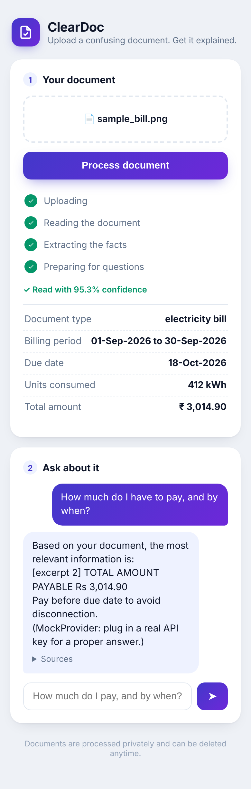

# ClearDoc

[](https://github.com/meghnavinod144/cleardoc/actions)

**Upload a confusing document. Get it explained — in your own language, by text or voice.**

ClearDoc is an AI assistant for the documents of everyday life: electricity
bills, medical lab reports, rental agreements, certificates. It reads real,
messy documents (crooked photos included), extracts the facts, answers
questions grounded in *your* document with citations — and knows when to say
"that's not in the document" instead of guessing.

<p align="center">
  
</p>

## Why it's built the way it is

- **India-first, world-ready** — the engine is country-neutral; document
  knowledge ships as plug-in modules (launch: utility bills + lab reports).
- **Honest by design** — answers cite their sources; OCR reports its own
  confidence; absent facts get refusals, not inventions; a question the
  document can't answer is part of the eval suite.
- **Privacy like an enterprise product** — bcrypt + JWT auth, per-user
  isolation (foreign documents are indistinguishable from nonexistent),
  originals auto-deleted after indexing, secrets never in Git.
- **Measured, not hoped** — a golden-set eval suite scores retrieval and
  answers *separately* on every run, so quality changes are numbers, not
  feelings ([latest scorecard](eval_reports/latest.json)).

## How it works

```
photo/PDF → OCR (Tesseract) → extract (LLM, schema-validated)
                 ↓
           chunk + embed  →  retrieve top-k  →  grounded answer + citations
                               (RAG)             in English / हिन्दी / മലയാളം
```

One **core pipeline** (upload → OCR → extract → index → ask) that knows
nothing about document types; each type is a **plug-in module** declaring its
keywords, extraction schema, and advice rules. Adding lab reports after bills
took one class. Voice input uses the browser's on-device speech recognition
(en-IN / hi-IN / ml-IN) with a server-side fallback socket; answers can be
spoken back via TTS.

## Stack

Python · FastAPI · SQLAlchemy (SQLite dev → PostgreSQL prod) · Tesseract +
Poppler · Gemini via a provider-agnostic LLM socket (Anthropic/OpenAI
drop-in) · vanilla JS mobile-first PWA frontend · Docker · GitHub Actions
(tests + container build/publish + scheduled evals) · pytest.

## Run it

```bash
pip install -r requirements.txt
uvicorn app.main:app --reload        # http://localhost:8000
# tests:  pytest        evals:  python -m evals.run_evals
# container: docker run -p 8000:8000 ghcr.io/meghnavinod144/cleardoc:latest
```

Set `GEMINI_API_KEY` (or `ANTHROPIC_API_KEY`) for the real brain; without a
key, a mock provider keeps everything runnable offline.

## The learning log

This project is also a documented apprenticeship: [`LEARNING.md`](LEARNING.md)
records every build session — including the bugs (a preprocessing "improvement"
that measurably hurt accuracy and was removed; an OCR upscale that silently
reordered two-column text; the CI pythonpath classic) and what each taught.
